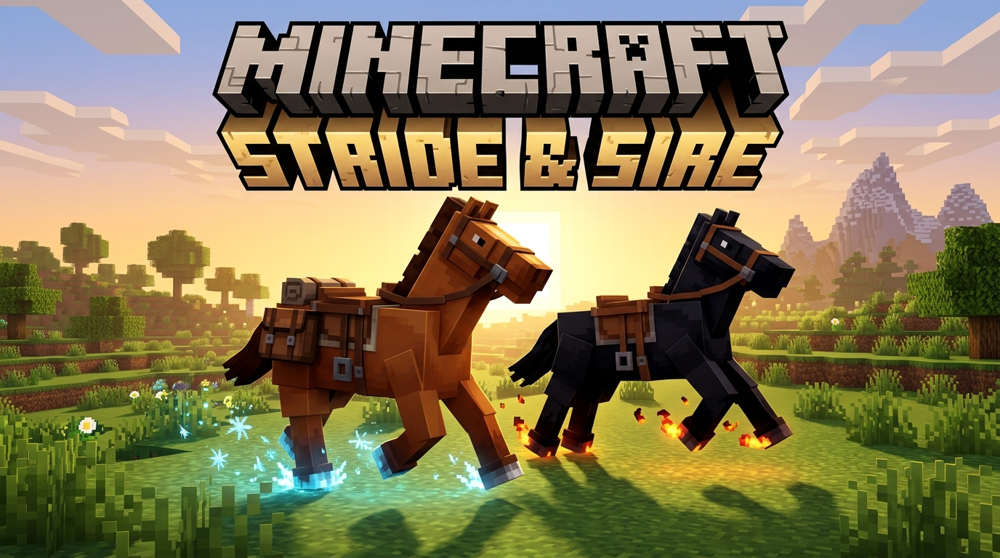
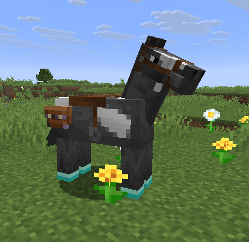
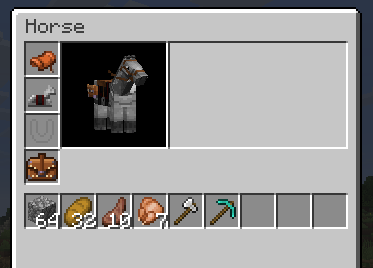
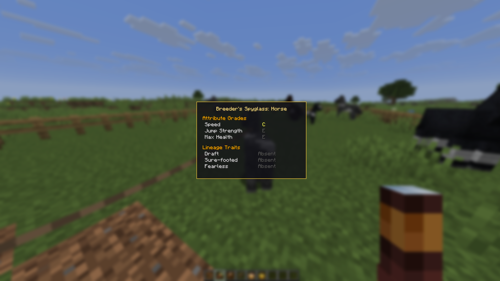
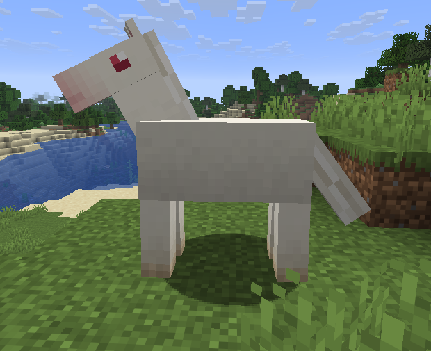

<p align="center">
  
</p>

<h1 align="center">Stride & Sire</h1>

<p align="center"><i>A Vanilla+ Minecraft Forge mod that gives horses the attention they deserve.</i></p>

<p align="center">
  
  
  
  
  
</p>

<p align="center">
  <a href="#features-at-a-glance">Features</a> ·
  <a href="#phase-a--horseshoes">Horseshoes</a> ·
  <a href="#phase-b--modular-saddlebags">Saddlebags</a> ·
  <a href="#phase-c--transparent-genetics">Genetics</a> ·
  <a href="#phase-d--mendelian-coat-genetics">Coat Genetics</a> ·
  <a href="#installation">Installation</a> ·
  <a href="README.pt-BR.md">Português</a>
</p>

---

Stride & Sire expands every equine in the game — Horse, Donkey, Mule, Skeleton
Horse, and Zombie Horse — with new equipment slots, a deeper breeding system, and
genetics players can actually see and plan around, without touching the base
game's spirit. Camels and Llamas are intentionally out of scope; this mod is
about the horse family.

<p align="center">
  
</p>

## Features at a glance

- **Horseshoes** — a dedicated equipment slot with 4 material tiers and 3
  custom enchantments that make fall damage, oceans, and lava no longer
  obstacles to exploring on horseback.
- **Modular Saddlebags** — a saddle-strapped inventory that gives Horses real
  carrying capacity and gives Donkeys/Mules even more, without replacing their
  chest.
- **Transparent Genetics** — see a horse's real stats with the Breeder's
  Spyglass, breed deliberately with diet-guided items, and grow passive lineage
  traits across generations.
- **Mendelian Coat Genetics** — three exclusive coat colors that never spawn in
  the wild, bred into existence through a focused Mendelian cross and locked in
  for life the moment a foal is born pure.

## Status

| Phase | Feature | Status |
|---|---|---|
| A | Horseshoes | ✅ Implemented |
| B | Modular Saddlebags | ✅ Implemented |
| C | Transparent Genetics (Breeder's Spyglass, diet-driven breeding, lineage traits) | ✅ Implemented |
| D | Mendelian Coat Genetics | ✅ Implemented |

Target platform: Minecraft Forge, Minecraft 26.3, Java 25.

## Phase A — Horseshoes

<p align="center">
  
</p>

An equipment slot entirely separate from the horse's armor/barding slot. Right-click
an eligible horse with an empty hand to open its inventory and fit a horseshoe
alongside the saddle and armor.

### Material tiers

| Tier | Durability | Passive effect (always on) | Exclusive enchantments it can hold |
|---|---|---|---|
| Copper | 100 | — | Feather Step, Frost Step |
| Iron | 200 | — | Feather Step, Frost Step |
| Diamond | 300 | — | Feather Step, Frost Step |
| Gold | 80 | +movement speed; Piglins stay neutral while mounted (same rule as wearing gold armor) | none |
| Netherite | 400 | Full immunity to fire/lava damage | Lava Walker, Feather Step |

Durability depletes with use; at zero, the horseshoe breaks (no anvil repair with
raw material — only **Mending** saves it). **Unbreaking** reduces wear odds
normally.

### Custom enchantments

- **Feather Step** — negates fall damage for the horse (and its rider). Usable on
  Copper, Iron, Diamond, and Netherite — not Gold.
- **Frost Step** — the horse freezes water under its hooves while moving, exactly
  like vanilla Frost Walker II; the ice melts after a few seconds. Usable on
  Copper, Iron, and Diamond only.
- **Lava Walker** — the horse walks on lava without sinking, like a Strider.
  Netherite exclusively.

Obtainable via enchanting table, anvil + enchanted book, or loot, same as any
vanilla enchantment.

<details>
<summary><strong>Crafting recipes</strong></summary>

Copper, Iron, Diamond, and Gold horseshoes share a shaped "U" recipe (5 ingots of the
tier's material):

```
I . I
I . I
. I .
```

Netherite has **no standalone recipe**. It's a Smithing Table upgrade, exactly
like vanilla Netherite tools and armor:

```
Diamond Horseshoe + Netherite Ingot + Netherite Upgrade Smithing Template
```

The upgrade preserves existing enchantments and the item's damage ratio. Iron
horseshoes no longer upgrade, and a horseshoe carrying Frost Step can't be
upgraded (Netherite can't hold it).

</details>

## Phase B — Modular Saddlebags

<p align="center">
  
</p>

A second equipment slot, strapped to the saddle, giving horses their own small
inventory — without replacing the chest that Donkeys and Mules already carry.

### Material tiers

| Tier | Slots | Special bonus |
|---|---|---|
| Leather | 9 | — |
| Iron | 9 | Contents survive the horse's death if it dies to an explosion |
| Diamond | 9 | Same explosion protection as Iron; not protected from fire/lava |
| Gold | 9 | Piglins stay neutral while mounted (same mechanism as the Gold Horseshoe) |
| Netherite | 9 | Contents are fire/lava-proof if the horse dies while burning |

Slot count is fixed at 9 by default for every tier — the only way to more
capacity is the Draft lineage trait from Phase C (see below), which exposes 18
slots on *any* material tier.

For Donkey and Mule, the saddlebag's slots are **additive** to their native
18-slot chest — 27 slots total (36 with Draft) when both are equipped, and the
two inventories never mix.

No durability — a saddlebag is permanent until you manually unequip it.

### Saddle dependency

A saddlebag can only be fitted once the horse already wears a saddle. If you
remove the saddle while a saddlebag (with contents) is equipped, the saddlebag is
automatically unstrapped and dropped on the ground as a normal item — its
contents travel with it intact. Removing the saddle is never blocked.

<details>
<summary><strong>Crafting recipes</strong></summary>

Same pattern as the horseshoes: Leather, Iron, Diamond, and Gold have their own
crafting recipe (Diamond: 2 diamonds + 5 leather); Netherite is a Smithing Table
upgrade from a Diamond saddlebag (+ Netherite Ingot + Netherite Upgrade Smithing
Template), carrying its stored items over unchanged. Iron saddlebags no longer
upgrade.

</details>

## Phase C — Transparent Genetics

<p align="center">
  
</p>

Vanilla horse breeding hides its math from the player. Stride & Sire makes it
visible and, with the right items, steerable — without turning it into a spreadsheet.

### Breeder's Spyglass

Shift + right-click an eligible horse while holding a Spyglass to open a
read-only report of its genetics: a letter grade (E to S) for Speed, Jump, and
Max Health, plus every lineage trait it carries — including **latent** ones
(inherited but not currently expressed, shown distinctly from manifest traits).
Doesn't consume the Spyglass or need durability; check as often as you like.

### Expanded attribute grades

Every horse's Speed, Jump, and Max Health ceiling is raised 20% above the
vanilla maximum, graded E through S:

| Grade | Range (% of vanilla max) | How to reach it |
|---|---|---|
| E | 0–25% | Wild spawn or any breeding |
| D | 25–50% | Wild spawn or any breeding |
| C | 50–75% | Wild spawn or any breeding |
| B | 75–100% (the vanilla ceiling) | Wild spawn or any breeding |
| A | 100–110% (above vanilla) | **Diet-guided breeding only** |
| S | 110–120% (the expanded ceiling) | **Diet-guided breeding only** |

A wild-spawned or plainly-bred horse never exceeds B — A and S are only reachable
by breeding with one of the diet items below.

### Diet-guided breeding

The item used to start breeding decides which attribute gets a shot at inheriting
from the stronger parent instead of a plain average:

| Item | Favored attribute |
|---|---|
| Golden Carrot | Speed |
| Golden Apple | Max Health |
| Glistering Melon Slice | Jump *(newly enabled as a horse breeding item by this mod)* |

Using any of the three unlocks the A/S range for **all three** attributes on
that foal; the item only decides which one additionally gets a 20% chance to
anchor on the better parent's value instead of the parents' average.

### Lineage traits

Breeding can pass down one or more of three passive traits. Each exists in one
of three states per horse — absent, **latent** (inherited, passable, but
inactive), or **manifest** (active) — and a horse can carry more than one at
once:

| Trait | Manifest effect |
|---|---|
| Draft | Unlocks 18 saddlebag slots instead of 9 (any material tier) |
| Sure-footed | Auto-steps 1.5–2 block ledges, goat-style |
| Fearless | Won't rear or dismount its rider from sudden zombie/creeper-explosion damage (still takes the damage) |

A foal has a low (1–2%) chance of spontaneously manifesting/carrying a trait
neither parent has, and a much higher (15–35%) chance if at least one parent
already carries it — breeding selectively keeps a trait in the line.

## Phase D — Mendelian Coat Genetics

<p align="center">
  <!-- TODO: add a screenshot of the three exclusive coats -->
  
</p>

Vanilla's horse color roll isn't the whole story anymore. Three coat colors
never appear on a wild-spawned Horse — they only exist as the payoff of a
small, deliberate breeding program. This phase is scoped to the Horse only:
Donkeys, Mules, Skeleton Horses, and Zombie Horses have no color variation in
vanilla and are unaffected.

### Exclusive coats

| Coat | Look |
|---|---|
| Obsidian | Solid, deep black — darker and glossier than vanilla Black, with no markings |
| Albino | Solid white with a matching white mane/tail and pink/red eyes (vanilla White keeps a contrasting mane) |
| Silver Dapple | A metallic silver dapple pattern with no vanilla equivalent |

### Single-gene Mendelian inheritance

Each coat is controlled by one independent dominant/recessive gene pair
(`AA`/`Aa`/`aa`) — simpler by design than Phase C's attributes and traits, so
this stays a short breeding puzzle rather than a second genetics system to
learn. Breeding is pure Mendel, with zero influence from diet items:

| Cross | Offspring odds |
|---|---|
| `AA` × `AA` | 100% `AA` |
| `AA` × `Aa` | 50% `AA`, 50% `Aa` |
| `AA` × `aa` | 100% `Aa` |
| `Aa` × `Aa` | 25% `AA`, 50% `Aa`, 25% `aa` |
| `Aa` × `aa` | 50% `Aa`, 50% `aa` |
| `aa` × `aa` | 100% `aa` |

Wild Horses can spawn as a silent carrier (`Aa`, a rare 3% chance per gene) but
never already showing the coat (`aa`) — inspect wild horses with the Breeder's
Spyglass to find carriers worth building a line around. If a horse ends up
`aa` pure in more than one gene at once, which coat is actually displayed is
chosen at random the moment it's born and stays fixed for that horse's life.

The exclusive coat fully replaces the horse's vanilla color and markings. It's
purely cosmetic — no stat bonus of any kind.

### Spyglass support

The Breeder's Spyglass report gained a third section listing the genotype
(`AA`, `Aa`, or `aa`) of all 3 genes for the inspected horse, alongside the
attribute grades and lineage traits from Phase C.

### Advancements

Breeding the first `aa`-pure specimen of each coat grants a one-time
advancement — three to chase for a completionist breeding program:

| Advancement | Earned by |
|---|---|
| Obsidian Coat | Breeding the first pure Obsidian foal |
| Albino Coat | Breeding the first pure Albino foal |
| Silver Dapple Coat | Breeding the first pure Silver Dapple foal |

## Installation

1. Install [Minecraft Forge](https://files.minecraftforge.net/) for Minecraft 26.3.
2. Download the latest `stride-and-sire-*.jar` from [Releases](../../releases) (or CurseForge, once published).
3. Drop the jar into your `mods` folder.

## Gallery

<p align="center">
  
  
  
</p>

## License

[MIT](LICENSE.txt)
